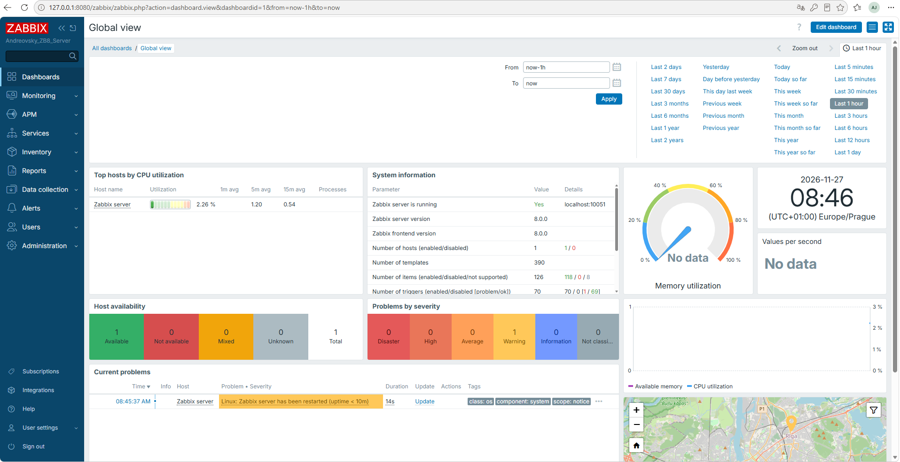
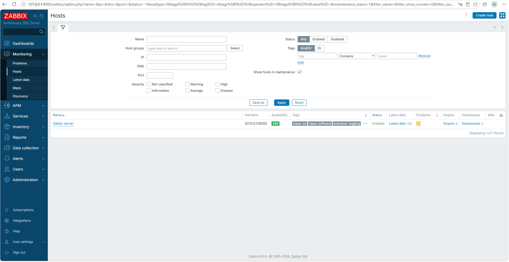
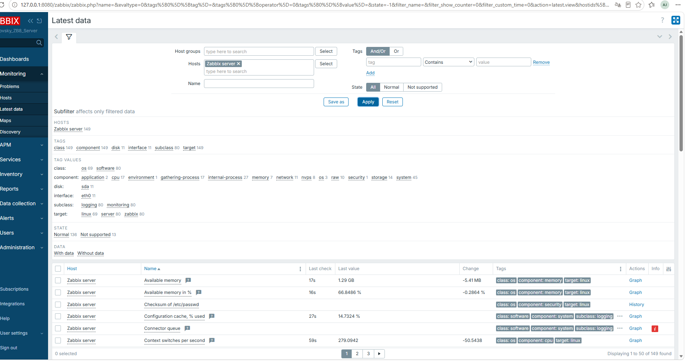
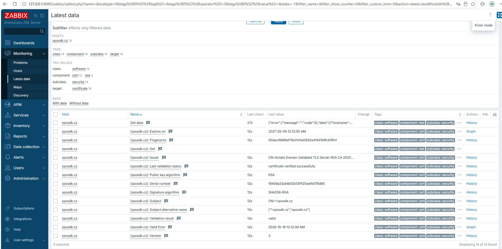
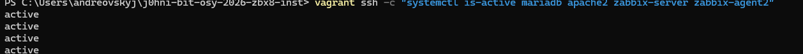

# Zabbix 8.0 LTS – Debian 13

## 1. Popis projektu

Tento projekt slouží k automatizované instalaci monitorovacího systému Zabbix 8.0 LTS na virtuální server Debian 13.

Virtuální stroj je vytvořen pomocí Vagrantu a VirtualBoxu. Instalace všech potřebných komponent probíhá automaticky prostřednictvím shell provisioningu.

## 2. Použité technologie

- Debian 13
- Vagrant
- VirtualBox
- Zabbix Server 8.0 LTS
- Zabbix Agent 2
- MariaDB
- Apache
- PHP

## 3. Požadavky

- Nainstalovaný VirtualBox
- Nainstalovaný Vagrant
- Připojení k internetu
- Minimálně 2 GB RAM pro virtuální stroj
- Dostatek volného místa na disku

## 4. Struktura projektu

```text
.
├── Vagrantfile
├── scripts/
│   └── install.sh
├── Images/
├── README.md
└── .gitignore
```

## 5. Instalace

Naklonování repozitáře:

```bash
git clone ADRESA_REPOZITARE
cd NAZEV_REPOZITARE
```

Spuštění virtuálního serveru:

```bash
vagrant up
```

Připojení do virtuálního stroje:

```bash
vagrant ssh
```

Opětovné spuštění provisioningu:

```bash
vagrant provision
```

Vypnutí serveru:

```bash
vagrant halt
```

## 6. Přístup k webovému rozhraní

Webové rozhraní Zabbixu je dostupné na adrese:

http://127.0.0.1:8080/zabbix

Výchozí přihlašovací údaje:

- Uživatelské jméno: `Admin`
- Heslo: `zabbix`

Po prvním přihlášení je doporučeno změnit výchozí heslo.



## 7. Databáze

Použita je databáze MariaDB.

- Název databáze: `zabbix`
- Databázový uživatel: `zabbix`
- Kódování: `utf8mb4`
- Heslo: automaticky generované při prvním spuštění

Databázové heslo je uloženo uvnitř virtuálního stroje v souboru `/root/.zabbix-db-password`.

Přístup k souboru je omezen na uživatele root.

Heslo není součástí Git repozitáře.

## 8. Monitorování místního serveru

Na virtuálním serveru je nainstalován Zabbix Agent 2.

Konfigurace:

- Hostname: `Zabbix server`
- IP adresa: `127.0.0.1`
- Port: `10050`
- Aktivní kontroly: `127.0.0.1`

V Zabbixu je místní server monitorován pomocí šablony **Linux by Zabbix agent**.

Dostupnost místního hosta:



Aktuální monitorovaná data:



## 9. Monitoring TLS/SSL certifikátu

Host `sposdk.cz` je vytvořen ručně se šablonou **Website certificate by Zabbix agent 2** a makrem `{$CERT.WEBSITE.HOSTNAME}` = `sposdk.cz`.

Monitoring slouží ke kontrole TLS/SSL certifikátu webové stránky https://sposdk.cz.

Výsledné hodnoty jsou dostupné v části **Monitoring → Latest data**.



## 10. Kontrola služeb

Funkčnost služeb lze ověřit příkazy:

```bash
systemctl is-active mariadb
systemctl is-active apache2
systemctl is-active zabbix-server
systemctl is-active zabbix-agent2
```

Všechny služby musí vracet stav `active`.



## 11. Screenshoty

Snímky obrazovky jsou uloženy v adresáři `Images/` a zobrazeny v kapitolách 6, 8, 9 a 10.

## 12. Řešení problémů

Kontrola Zabbix Serveru:

```bash
sudo journalctl -u zabbix-server -n 50
```

Kontrola Agenta:

```bash
sudo journalctl -u zabbix-agent2 -n 50
```

Kontrola MariaDB:

```bash
sudo journalctl -u mariadb -n 50
```

Kontrola Apache:

```bash
sudo journalctl -u apache2 -n 50
```

### Potíž při instalaci: balíček grub-pc

Provisioning skončil chybou při konfiguraci balíčku `grub-pc`, protože nebyl správně určen instalační disk. Skript nyní disk zjistí, nastaví ho přes `debconf-set-selections` a dokončí instalaci příkazem `dpkg --configure -a`.
